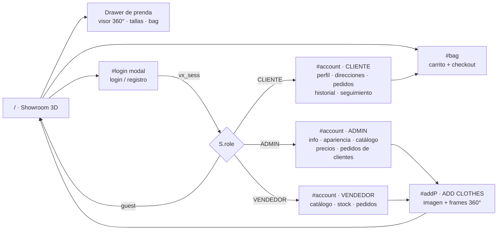

# Arquitectura adaptada — ATELIER/VX Showroom 3D

> Estado: **Fases 1, 1.5, 2, 5 y 6 implementadas**. Modelos, gateway de persistencia, servicios, bitácora, guards por rol, `VENDEDOR`, categorías dinámicas, stock por talla con reserva en checkout, modo inmersivo y ambiente 3D están activos; el visor 360° no se ha modificado. Este documento adapta la especificación de plataforma React/Express/MongoDB a la aplicación real: **Vite + módulos ES + Three.js + `localStorage`**.
>
> Regla de oro: **se conserva la esencia de showroom virtual interactivo 3D**. `src/scene3d.js` (concreto, neón, percheros, cámara/raycast) y `src/viewer360.js` (giro a 14°/s, arrastre, PAUSE/PLAY) no se sustituyen ni se degradan a una galería 2D. La galería `#car` sigue siendo solo el *fallback* móvil/sin WebGL.

---

## 0. Stack solicitado → decisión adaptada

| Stack del prompt | Adaptación al proyecto actual | Por qué |
|---|---|---|
| React + React Router + Tailwind | **Vite + módulos ES + CSS propio** (`styles/`). Los "componentes" son módulos; las "rutas" son vistas/paneles gobernadas por `S.role` | Migrar a React obligaría a reescribir el ciclo de la escena Three.js y el visor 360°. El objetivo es **mejorar**, no reemplazar |
| Express controllers (ES modules) | `src/controllers/*.js` siguen siendo los coordinadores de vista (`auth.js`, `catalog.js`, `account.js`, `admin.js`), ahora **adelgazados** delegando a servicios | Ya son `import`/`export` y `async` donde hace falta |
| Mongoose models | `src/models/*.model.js`: esquemas declarativos con `required`, `enum`, `default`, `collection`, índices y validadores | Misma disciplina de datos, sin driver de DB |
| MongoDB | `localStorage` con claves explícitas `vx_*`, detrás de una única puerta `src/services/storage.js` | Hoy no hay backend; el contrato de datos queda listo para migrar |
| JWT (`jsonwebtoken`) | Payload de sesión equivalente `{ sub, email, rol }` derivado de `vx_sess` (`src/context/AuthContext.js` → `S` + `bus`) | El rol **siempre** sale de la sesión, nunca del body ni de atributos ocultos del DOM |
| `bcryptjs` | `passwordHash` SHA-256 demo en `vx_accts`, con `select: false` semántico (nunca se renderiza) | bcrypt real exige backend; se documenta como deuda técnica, no se finge |
| Docker Compose + Makefile | Diferido a la fase de backend real | No aplica a un estático servido por Vite |
| `apiFetch` único | `src/services/storage.js` (lectura/escritura) + `src/services/api.js` (contrato futuro HTTP) | Fase 1 cerró la deuda: el smoke verifica que `localStorage` solo se usa en `storage.js` |
| `<RutaProtegida>` | Guardas por rol en servicios (`autorizar*`) y vistas (`esGestor`, `esAdmin`), con `#bAdd.hidden = !esGestor(role)` | Equivalente funcional dentro de una SPA sin router |

**Convenciones que se mantienen igual:** dominio en español (`productos`, `precio`, `stock`), comentarios/JSDoc en inglés para código nuevo, estados en MAYÚSCULAS sin tildes, precios como `Number`, `timestamps`, soft delete (`activo: false`), errores `{ mensaje, error }` y códigos `200/201/400/401/403/404/409/500`.

---

## 1. Árbol de carpetas objetivo

`[existe]` = archivo actual. `[hecho]` = creado en Fase 1. `[pendiente]` = reservado para fases posteriores.

```
ATELIER_VX/
├── index.html                       [existe] header, drawer, #account, #addP, #bag, #login
├── vite.config.js                   [existe] puerto 5174
├── package.json                     [existe] three + vite
├── docs/
│   └── ARQUITECTURA.md              [hecho] este documento
├── scripts/
│   └── smoke.mjs                    [hecho] smoke de servicios + detector de localStorage directo
├── styles/
│   ├── base.css                     [existe] variables, reset, [hidden]
│   ├── layout.css                   [existe] paneles, modal, responsive
│   └── components.css               [existe] .pd-*, .v360, .acc-*, formularios
└── src/
    ├── main.js                      [existe] bootstrap de init*
    ├── immersive.js                 [hecho Fase 5] HUD ocultable + Fullscreen API, sin tocar la escena
    ├── config.js                    [existe] BASE, SIZES, constantes de estado
    ├── state.js                     [existe] S (única fuente de verdad en memoria)
    ├── bus.js                       [existe] eventos entre módulos
    ├── utils.js                     [existe] $, money, esc, shade, sha, loadImg
    ├── models/                      [hecho] equivalente a los schemas de Mongoose
    │   ├── constantes.js            [hecho] roles, estados y transiciones
    │   ├── index.js                 [hecho] normalizar / validar / publico
    │   ├── usuarios.model.js        [hecho]
    │   ├── clientes.model.js        [hecho]
    │   ├── categorias.model.js      [hecho]
    │   ├── productos.model.js       [hecho] incluye imágenes embebidas y atributos3d
    │   ├── variantes.model.js       [hecho] embebida en productos / colección opcional
    │   ├── pedidos.model.js         [hecho]
    │   └── bitacora.model.js        [hecho] append-only
    ├── services/                    [hecho] capa de persistencia y reglas
    │   ├── storage.js               [hecho] ÚNICO acceso a localStorage (equivale a apiFetch)
    │   ├── auth.service.js          [hecho] login, registro, logout, session()
    │   ├── clientes.service.js      [hecho] perfil y direcciones
    │   ├── categorias.service.js    [hecho] filtros del showroom
    │   ├── productos.service.js     [hecho] catálogo, precios, estados, soft delete
    │   ├── pedidos.service.js       [hecho] checkout, transiciones, tracking
    │   ├── bitacora.service.js      [hecho] registro inmutable de cambios de estado
    │   ├── permisos.js              [hecho] guards 401/403 + esGestor/esAdmin
    │   ├── variantes.service.js     [hecho Fase 2] SKU, siembra, stock y reserva con rollback
    │   └── api.js                   [pendiente] contrato HTTP futuro (Fase 3)
    ├── controllers/                 [existe] coordinadores de vista (delgados)
    │   ├── auth.js                  [existe] sesión/roles → AuthContext
    │   ├── catalog.js               [existe] drawer, bag, checkout → products/orders
    │   ├── account.js               [existe] panel cliente/admin → clientes/pedidos/productos
    │   └── admin.js                 [existe] ADD CLOTHES → productos
    ├── context/                     [nuevo] equivalente a AuthContext
    │   └── AuthContext.js           [nuevo] sesión global derivada de vx_sess + bus
    ├── scene3d.js                   [existe] escena, percheros, neón, cámara + vida ambiente (Fase 5)
    ├── viewer360.js                 [existe] ★ NO TOCAR: 360° dentro del drawer
    ├── svg.js                       [existe] dibujo de prendas sin imagen
    ├── ui.js                        [existe] openPanel/closePanel/note
    └── hero.js                      [existe] titular y filtros
```

Carpetas **no creadas ahora**, reservadas para cuando exista backend real / migración de UI: `backend/src/{config,models,controllers,routes,middlewares,services,fixtures}`, `frontend-react/src/{services,context,components,pages,pages/panel,layouts}`. No se añaden dependencias nuevas.

---

## 2. Esquemas de colecciones

Nota de mapeo: `roles` del prompt (`ADMIN | VENDEDOR | CLIENTE`) ↔ estado actual (`admin | client | guest`). `INVITADO` no es colección: es `S.role === 'guest'` sin cuenta. `VENDEDOR` es nuevo y comparte permisos de catálogo con `ADMIN`, sin gestión de usuarios.

Todos los schemas declaran `timestamps: true` y `collection` explícita. `activo: false` = soft delete.

### 2.1 `usuarios` → clave `vx_accts` (+ constantes demo en `auth.js`)

| Campo | Tipo | Required | Enum / Default | Notas |
|---|---|---|---|---|
| `id` | String | sí | — | Email normalizado en la demo; `unique: true` |
| `email` | String | sí | — | `lowercase`, `unique: true` |
| `passwordHash` | String | sí | — | SHA-256 demo; **`select: false`**: jamás se envía al perfil ni se renderiza |
| `nombre` | String | sí | — | Se refleja en `#bUser` |
| `rol` | String | sí | `CLIENTE \| VENDEDOR \| ADMIN`, default `CLIENTE` | Source of truth: sesión, no body |
| `activo` | Boolean | sí | `true` | Soft delete |
| `creadoEn`, `actualizadoEn` | Date | auto | `timestamps` | |

### 2.2 `clientes` → clave `vx_profiles`

| Campo | Tipo | Required | Enum / Default | Notas |
|---|---|---|---|---|
| `id` | String | sí | — | Igual a `usuarios.id` |
| `usuarioId` | String → `usuarios` | sí | — | Separa cuenta de persona de negocio |
| `nombre` | String | sí | — | Editable en `01 / PERFIL` |
| `email` | String → `usuarios` | sí | — | Solo lectura en UI |
| `telefono` | String | no | `''` | Editable en `01 / PERFIL` |
| `direcciones` | Array&lt;Direccion&gt; | no | `[]` | Embebidas: `{ id, etiqueta, calle, ciudad, cp, pais, principal }` |
| `activo` | Boolean | sí | `true` | Soft delete |
| `creadoEn`, `actualizadoEn` | Date | auto | `timestamps` | |

Regla: exactamente **una** dirección con `principal: true` mientras exista al menos una.

### 2.3 `categorias` → clave `vx_categorias` `[nuevo]`

Hoy se infiere de `config.js` (`bomber|coat` → OUTERWEAR; `hoodie|cargo` → ESSENTIALS). Se explicita para no acoplar filtros a `type`.

| Campo | Tipo | Required | Enum / Default | Notas |
|---|---|---|---|---|
| `id` | String | sí | — | |
| `nombre` | String | sí | — | `unique: true`, uppercase |
| `slug` | String | sí | — | `outer`, `essential`, `accesorios` → coincide con `#filters [data-filter]` |
| `descripcion` | String | no | `''` | |
| `activo` | Boolean | sí | `true` | Soft delete |
| `creadoEn`, `actualizadoEn` | Date | auto | `timestamps` | |

Seed: `OUTERWEAR/outer`, `ESSENTIALS/essential`, `ACCESORIOS/accesorios`.

### 2.4 `productos` → `config.js BASE` + clave `vx_customs` (destino `vx_productos`)

**Aquí se preserva el motor 3D**: `atributos3d` guarda lo que hoy consumen `scene3d.js` y `viewer360.js`.

| Campo | Tipo | Required | Enum / Default | Notas |
|---|---|---|---|---|
| `id` | String | sí | — | `unique: true` (`h1`, `b1`, `c…`) |
| `nombre` | String | sí | — | Uppercase en UI |
| `descripcion` | String | no | `''` | Texto del drawer |
| `precio` | Number | sí | `0` | **Nunca texto**; `money()` solo formatea al pintar |
| `categoriaId` | String → `categorias` | sí | — | Antes: `type` derivado |
| `imagenes` | Array&lt;{ url, orden }&gt; | sí | `[]` | **Embebidas**, `orden` paragalería; `url` puede ser dataURL WebP |
| `color` | String | no | `#888888` | Hex del swatch y del material 3D |
| `colorNombre` | String | no | `ATELIER` | `COLOUR — …` |
| `tallas` | Array&lt;String&gt; | sí | `['M']` | `XS \| S \| M \| L \| XL` (derivado de variantes) |
| `estado` | String | sí | `DISPONIBLE \| AGOTADO \| EN_OFERTA \| INACTIVO`, default `DISPONIBLE` | Máquina de estados §6 |
| `atributos3d` | Object | no | ver abajo | ★ Imprescindible para no perder el showroom |
| `activo` | Boolean | sí | `true` | Soft delete en vez de borrar |
| `creadoEn`, `actualizadoEn` | Date | auto | `timestamps` | |

`atributos3d = { img: String|null, w: Number, h: Number, frames: [String], velocidadGiro: Number = 14, rack: 'left'|'right' }`.
- `frames` = secuencia 360° subida en `#cFrames` (hasta 12). Si está vacía, `viewer360.js` rota el SVG con perspectiva 3D.
- `velocidadGiro = 14` cumple el requisito de giro lento; no se modifica.

### 2.5 `variantes` → clave activa `vx_variantes` (servicio `variantes.service.js`)

| Campo | Tipo | Required | Enum / Default | Notas |
|---|---|---|---|---|
| `sku` | String | sí | — | `unique: true`; determinista: `${productoId}-${talla}-${COLOR}` → `B1-M-OLIVE` |
| `productoId` | String → `productos` | sí | — | Referencia al producto canónico |
| `talla` | String | sí | `XS \| S \| M \| L \| XL` | |
| `color` | String | no | `VX` | Nombre de color del catálogo (`OLIVE`, `ASH`, `ATELIER`), no hex |
| `stock` | Number | sí | `0` | Entero ≥ 0; base `12`, custom `10` al publicar |
| `precio` | Number | no | `productos.precio` | Override opcional |
| `activo` | Boolean | sí | `true` | Soft delete al dar de baja el producto |
| `creadoEn`, `actualizadoEn` | Date | auto | `timestamps` | |

Decisión Fase 2: colección **separada y activa**, no embebida. `variantes.service.js` siembra las variantes que faltan desde `S.garments` y `vx_customs`, de modo que el catálogo legacy siga teniendo stock sin migración manual. `productos.crear()` genera variantes con rollback si falla; `productos.eliminar()` las desactiva con restauración del snapshot si falla. `inspect()` deriva las tallas disponibles de `disponible()` y deshabilita las agotadas.

### 2.6 `pedidos` → clave `vx_orders`

| Campo | Tipo | Required | Enum / Default | Notas |
|---|---|---|---|---|
| `id` | String | sí | — | `unique: true`, `VX-######` |
| `clienteId` | String → `clientes` | no | `null` | `null` = compra de invitado |
| `clienteEmail` | String | no | `''` | Copia de la sesión; filtra `ordersOf(email)` |
| `clienteNombre` | String | sí | `Invitado` | Snapshot: no cambia si el perfil se edita |
| `items` | Array&lt;Item&gt; | sí | `[]` | `{ productoId, nombre, talla, color, cantidad, precioUnitario, subtotal }` (snapshot) |
| `total` | Number | sí | `0` | Suma de `subtotal` |
| `estado` | String | sí | `PENDIENTE \| PAGADO \| ENVIADO \| ENTREGADO \| CANCELADO`, default `PENDIENTE` | §6 |
| `tracking` | String | sí | — | `VX########`, visible en `05 / SEGUIMIENTO` |
| `direccion` | Object | no | `null` | Snapshot de la dirección principal al comprar |
| `historial` | Array&lt;{ estado, fecha, usuarioId }&gt; | sí | `[]` | Traza de transiciones |
| `activo` | Boolean | sí | `true` | Soft delete |
| `creadoEn`, `actualizadoEn` | Date | auto | `timestamps` | `creadoEn` es la `fecha` que hoy muestra `dateOf()` |

Mapeo de estados actuales → nuevos (sin tildes): `Confirmado → PENDIENTE`, `En preparación → PAGADO`, `En camino → ENVIADO`, `Entregado → ENTREGADO`. Se añade `CANCELADO`.

### 2.7 `bitacora` → clave `vx_bitacora` `[nuevo]`

Append-only: sin `update` ni `delete` expuestos.

| Campo | Tipo | Required | Enum / Default | Notas |
|---|---|---|---|---|
| `id` | String | sí | — | autoincremental local |
| `usuarioId` | String → `usuarios` | sí | — | Viene de la sesión (`sub`) |
| `usuarioEmail` | String | sí | — | Snapshot legible |
| `accion` | String | sí | `LOGIN \| LOGOUT \| CREAR \| EDITAR \| CAMBIAR_ESTADO \| CAMBIAR_PRECIO \| ELIMINAR` | |
| `entidad` | String | sí | `USUARIO \| CLIENTE \| CATEGORIA \| PRODUCTO \| VARIANTE \| PEDIDO` | |
| `entidadId` | String | sí | — | |
| `estadoAnterior` | String \| null | no | `null` | |
| `estadoNuevo` | String \| null | no | `null` | |
| `detalle` | String | no | `''` | p. ej. `precio 180 → 190` |
| `fecha` | Date | auto | `now` | |
| `creadoEn`, `actualizadoEn` | Date | auto | `timestamps` | |

### 2.8 Colecciones de soporte (ya existen, se mantienen)

| Clave | Contenido | Equivalente conceptual |
|---|---|---|
| `vx_sess` | Email/identificador de sesión | Payload JWT mínimo `{ sub, email, rol }` |
| `vx_settings` | Textos, `accent`, `kicker`, `prices` | Configuración de tenant |
| `vx_bag` | Carrito `{ g, z, q }[]` | Carrito efímero del CLIENTE |

---

## 3. Tabla de relaciones

| Desde | Hacia | Cardinalidad | Campo | Comportamiento |
|---|---|---|---|---|
| `usuarios` | `clientes` | 1 : 1 | `clientes.usuarioId` | Cuenta separada de persona de negocio |
| `categorias` | `productos` | 1 : N | `productos.categoriaId` | Soft delete de categoría → productos `INACTIVO`, no borrado físico |
| `productos` | `variantes` | 1 : N (embebida) | `variantes.productoId` + `sku` único | Stock por talla/color |
| `clientes` | `pedidos` | 1 : N | `pedidos.clienteId` | Invitados permitidos (`null`) |
| `productos` | `pedidos.items` | 1 : N (snapshot) | `items.productoId` | Precio/nombre quedan fijados en la orden |
| `usuarios` | `bitacora` | 1 : N | `bitacora.usuarioId` | Solo inserción; nunca se altera |
| `usuarios` | `pedidos` (admin) | 1 : N | `historial[].usuarioId` | Quién cambió el estado |

Índices únicos: `usuarios.email`, `clientes.id`, `categorias.nombre`, `productos.id`, `variantes.sku`, `pedidos.id`.

---

## 4. Endpoints / servicios por recurso

Hoy no hay HTTP: la columna **Servicio (hoy)** es el equivalente real que se implementaría en la Fase 1. La columna **Contrato API** queda reservada para el backend futuro. Rol y `id` **siempre** desde la sesión (`AuthContext` → `vx_sess`), nunca del body.

| Recurso | Método | Ruta futura | Rol | Servicio (hoy) | Evento `bus` |
|---|---|---|---|---|---|
| Auth | POST | `/api/auth/login` | público | `auth.service.login(email, password)` | `auth:change` |
| Auth | POST | `/api/auth/registro` | público | `auth.service.registrar(...)` | `auth:change` |
| Auth | POST | `/api/auth/logout` | autenticado | `auth.service.logout()` | `auth:logout` |
| Auth | GET | `/api/auth/perfil` | autenticado | `auth.service.session()` | — |
| Clientes | GET | `/api/clientes/:id` | CLIENTE, ADMIN, VENDEDOR | `clientes.service.obtener(sub)` | — |
| Clientes | PATCH | `/api/clientes/:id` | CLIENTE, ADMIN | `clientes.service.actualizar(sub, datos)` | — |
| Direcciones | POST/PATCH/DELETE | `/api/clientes/:id/direcciones` | CLIENTE, ADMIN | `clientes.service.direccion.*` | — |
| Categorías | GET | `/api/categorias` | público | `categorias.service.listar()` | `catalog:refresh` |
| Categorías | POST/PATCH | `/api/categorias` | ADMIN, VENDEDOR | `categorias.service.guardar()` | `catalog:refresh` |
| Variantes | GET | `/api/variantes/:productoId` | público | `variantes.service.listar()` / `disponible()` | — |
| Variantes | POST | `/api/variantes` | ADMIN, VENDEDOR | `variantes.service.crearParaProducto()` | `catalog:refresh` |
| Productos | GET | `/api/productos` | público | `productos.service.listar()` | `catalog:refresh` |
| Productos | GET | `/api/productos/:id` | público | `productos.service.obtener(id)` | — |
| Productos | POST | `/api/productos` | ADMIN, VENDEDOR | `productos.service.crear(datos)` | `customs:sync` |
| Productos | PATCH | `/api/productos/:id/precio` | ADMIN, VENDEDOR | `productos.service.precio(id, número)` | `catalog:refresh` |
| Productos | PATCH | `/api/productos/:id/estado` | ADMIN, VENDEDOR | `productos.service.estado(id, estado)` | `catalog:refresh` |
| Productos | DELETE | `/api/productos/:id` | ADMIN, VENDEDOR | `productos.service.eliminar(id)` → `activo:false` | `customs:sync` |
| Pedidos | POST | `/api/pedidos` | CLIENTE (o invitado) | `pedidos.service.crear(carrito, sub)` + descuento stock | `orders:change` |
| Pedidos | GET | `/api/pedidos/mios` | CLIENTE | `pedidos.service.mios(sub)` | `orders:change` |
| Pedidos | GET | `/api/pedidos` | ADMIN, VENDEDOR | `pedidos.service.todos()` | `orders:change` |
| Pedidos | PATCH | `/api/pedidos/:id/estado` | ADMIN, VENDEDOR | `pedidos.service.estado(id, estado, sub)` | `orders:change` |
| Bitácora | GET | `/api/bitacora` | ADMIN | `bitacora.service.listar()` | — |

Códigos de respuesta: `200` lectura/actualización, `201` creación, `400` validación, `401` sin sesión, `403` rol insuficiente, `404` no encontrado, `409` transición inválida o stock insuficiente, `500` error inesperado. Formato de error: `{ mensaje, error }`.

---

## 5. Rutas del frontend (adaptadas a SPA sin React Router)



Guardas de rol (equivalente a `<RutaProtegida>`):

| Vista | Guarda actual | Equivalente React Router |
|---|---|---|
| `#account` | `if (S.role === 'guest') return;` en `openAccount()` | `<RutaProtegida roles={['CLIENTE','ADMIN','VENDEDOR']}>` |
| Catálogo y pedidos en `#account` | `esGestor(S.role)` en `render()`/`bind()` | `<RutaProtegida roles={['ADMIN','VENDEDOR']}>` |
| Apariencia y bitácora en `#account` | `S.role === 'admin'` en `render()`/`bind()` | `<RutaProtegida roles={['ADMIN']}>` |
| `#addP` y botón `#bAdd` | `#bAdd.hidden = !esGestor(role)` en `auth.js`/`admin.js` | `<RutaProtegida roles={['ADMIN','VENDEDOR']}>` |

Cada pantalla/resolución debe manejar **tres estados**: cargando (mensaje `Procesando…` / `Verificando…`), error (`#accountMsg`, `#lm`, `#addMsg`) y lista vacía (`Sin direcciones guardadas`, `Todavía no hay pedidos`, `Tu bag está vacía`).

---

## 6. Máquinas de estado

### Producto

```
DISPONIBLE ──> AGOTADO
DISPONIBLE ──> EN_OFERTA
DISPONIBLE ──> INACTIVO
AGOTADO    ──> DISPONIBLE
EN_OFERTA  ──> DISPONIBLE | INACTIVO
INACTIVO   ──> DISPONIBLE | AGOTADO
```
Cualquier otra transición ⇒ `409 CONFLICTO` y `bitacora` registra `estadoAnterior → estadoNuevo` solo si se acepta.

### Pedido

```
PENDIENTE ──> PAGADO ──> ENVIADO ──> ENTREGADO
PENDIENTE ──> CANCELADO
PAGADO    ──> CANCELADO
```
`ENVIADO`/`ENTREGADO`/`CANCELADO` son terminales. Transiciones inválidas ⇒ `409`.

### Reserva de stock (Fase 2)

Contrato de `variantes.service.js`:

- `skuDe(productoId, talla, color)` → `${productoId}-${talla}-${COLOR}` en MAYÚSCULAS, sin caracteres no alfanuméricos.
- `sembrar()` crea variantes ausentes con `STOCK_BASE = 12` (catálogo base) o `STOCK_CUSTOM = 10` (prendas publicadas); es idempotente.
- `disponible(productoId, talla, color)` → entero ≥ 0; el drawer la usa para deshabilitar tallas agotadas y limitar la cantidad.
- `stockPorTalla(productoId)` → máximo entre variantes activas; los paneles de ADMIN/VENDEDOR muestran este valor, nunca la suma de tallas ni un `stock` guardado que pueda quedar obsoleto.
- `descontar(items)` reserva **todas** las tallas del carrito antes de escribir el pedido. SKUs repetidos se suman; falta de stock o variante inactiva → `409`/`404` sin mutar nada.
- `pedidos.crear()` hace rollback de la reserva si falla la escritura del pedido. `productos.crear()`/`eliminar()` usan `todas()` + `restaurar()` para mantener `vx_variantes` coherente con `vx_productos`.

### Flujo de negocio (sin cambios)

Navegar showroom 3D → click en perchero → drawer con 360° → elegir talla/cantidad (limitada por stock) → agregar al carrito → crear pedido (**descuenta `variantes.stock`**) → `PENDIENTE → PAGADO` → `ENVIADO` → `ENTREGADO`. Cada cambio relevante escribe en `bitacora`.

---

## 7. Fases (sin tocar la escena 3D ni el visor 360°)

1. **Fase 1 — disciplina de datos (sin cambios visuales) — COMPLETADA.** Creados `src/models/`, `src/services/storage.js`, los `*.service.js` y `bitacora`. Todos los accesos a `localStorage` pasan por `storage.js`. Los estados son MAYÚSCULAS sin tildes y las etiquetas de display siguen en español. Sin nueva UI.
1.5. **Fase 1.5 — blindaje — COMPLETADA.** `src/services/permisos.js` aplica guards `401/403` desde la sesión en servicios de catálogo, pedidos, clientes y bitácora. El selector de estados deshabilita transiciones inválidas y conserva el `409` como red.
2. **Fase 2 — rol `VENDEDOR` y catálogo rico — COMPLETADA.** Categorías explícitas y filtros dinámicos (`#carEmpty`), `vx_variantes` con SKU determinista y stock por talla, drawer con tallas agotadas deshabilitadas, checkout con reserva/rollback que conserva el bag si falla, `VENDEDOR` con permisos de catálogo/pedidos sin apariencia ni auditoría, y bitácora visible solo para ADMIN. `vx_productos`/`vx_variantes` son destinos activos con rollback. `npm run smoke` ejecuta 71 comprobaciones sin dependencias; `npm run verify` = build + smoke. La auditoría final añadió E2E headless con Edge CDP (53 comprobaciones de UI real sobre una copia temporal de `index.html`, eliminada después) y `stockPorTalla()` para los paneles de gestores. El drawer 360° sigue consumiendo `atributos3d`.
3. **Fase 3 — backend real (opcional).** `backend/` Express + Mongoose + JWT + bcrypt con los mismos modelos y contrato de endpoints del §4; `frontend/src/services/api.js` cambia de `storage.js` a `apiFetch` sin tocar los controladores de vista.
4. **Fase 4 — migración de UI (opcional).** React + Router + Tailwind; `scene3d.js` y `viewer360.js` se montan como componentes imperativos vía `useEffect`, manteniendo el showroom.
5. **Fase 5 — inmersión (COMPLETADA).** `src/immersive.js` retira el HUD decorativo y usa Fullscreen API con salida por `ESC`/control explícito; el drawer y el canvas siguen interactivos. `scene3d.js` gana polvo en suspensión, respiración del neón y parallax mínimo con el puntero, desactivables con `prefers-reduced-motion`. El visor 360° y sus 14°/s no se tocan. `npm run verify` = 43 módulos + 71/71; E2E con Edge CDP 14/14 sobre la UI real.
6. **Fase 6 — cuenta lateral tipo referencia (COMPLETADA).** `#account` pasa a `min(920px, 96vw)` y `#accountBody.acc2` a un grid `290px | 1fr`: **menú vertical a la izquierda** (cabecera, avatar circular de 54 px con saludo, grupos con divisores e ítem activo con barra de acento de 3 px) y **contenido a la derecha** en tarjetas compactas (`.acc2-msg`); por debajo de 760 px las columnas se apilan. `navGroups()` filtra por rol: el cliente ve perfil/compras/favoritos; el vendedor ve su perfil, catálogo y ventas; el admin añade tienda y auditoría. Ningún rol muestra opciones de otro. Los pedidos conservan pestañas, buscador, periodo, miniatura, línea de tiempo de 4 pasos y comprobante. El chip de puntos y la sección `TARJETAS Y DATOS PARA REEMBOLSO` se retiraron de la interfaz; `src/services/cuenta.service.js` conserva esas funciones aparcadas y `vx_cuenta` mantiene los favoritos. El título de sección va en el flujo normal (máx. 22 px) para no tapar `MI CUENTA`; el antiguo `<header>` pasó a `<div>` porque la regla global `header { position: fixed }` lo sacaba del panel. Cliente, `VENDEDOR` y `ADMIN` comparten el panel; ADMIN conserva apariencia y bitácora. El alta de prendas usa `addFormHTML()` en `src/admin.js`, compartido con el modal. Los guards, el stock y la escena 3D no cambian. E2E: comprobaciones de UI real (cliente, admin y vendedor, con menú vertical, contenido al lado, aislamiento por rol y ausencia de puntos/reembolsos) + modal `ADD CLOTHES` intacto.

---

## 8. Qué NO cambia

- `src/viewer360.js` y `src/svg.js` (intactos). `scene3d.js` solo recibió la capa ambiente (polvo, respiración del halo y parallax), sin alterar concreto, percheros, neón ni controles. `index.html` y `styles/*` recibieron además `#bImmersive`, `#xImmersive` y las reglas `.immersive`.
- Las 8 prendas base de `config.js` y sus atributos `img/w/h/frames`.
- Velocidad del giro 360° (14°/s), arrastre y PAUSE/PLAY.
- Credenciales demo `cliente@vx.com / cliente123`, `vendedor@vx.com / vendedor123` y `admin@vx.com / admin1234`.
- `passwordHash` con semántica `select: false`, jamás renderizado; `vx_customs` sigue siendo la fuente visible de prendas publicadas.
- Servidor Vite en `http://localhost:5174`.
